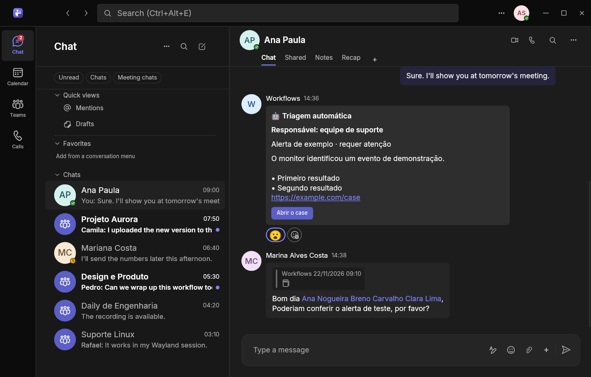

<p align="center">
  
</p>

<h1 align="center">Teams Linux</h1>

<p align="center"><strong>An unofficial, native Microsoft Teams client for Linux. Built in Rust.</strong></p>

<p align="center">
  <a href="#try-the-demo">Try the demo</a> ·
  <a href="#build-and-install">Build and install</a> ·
  <a href="#contribute">Contribute</a> ·
  <a href="BACKLOG.md">Roadmap</a>
</p>

<p align="center">
  
  
  <a href="LICENSE"></a>
</p>

<p align="center">
  
  <br>
  <sub>The native app in demo mode, with fictional conversations.</sub>
</p>

Teams Linux brings work-account chats and calendars to the Linux desktop. Its
interface is rendered with Iced and wgpu, with light and dark themes,
configurable text size, and a resizable chat list.

## Try the demo

Explore the interface with sample data. The demo requires no Teams account.

```sh
git clone https://github.com/gutopardini/teams-linux-rs.git
cd teams-linux-rs
cargo run --locked -- --demo
```

The demo build needs Rust, a C toolchain, and OpenSSL development files
(`openssl-devel` on Fedora).

## What's in the app

- **Chat** — conversation history, rich text, attachments, mentions, quoted replies, emoji reactions, and desktop notifications.
- **Organization** — favorites, drafts, unread filters, and adjustable chat and text sizing.
- **Calendar** — day, week, and agenda views, with meeting details and a pre-join screen.
- **Languages** — English is the default. Switch to Brazilian Portuguese under **Settings → Appearance → App language**.

**Calls, meetings, and screen sharing are experimental.** The
[libwebrtc notes](docs/media.md) explain the
current media support and what has been tested on the live service.

## Contribute

Trying the app on your Linux setup, improving a translation, or adding a
small regression test all move the project forward.

| I want to… | Start here |
| --- | --- |
| Report a bug | [Open an issue](https://github.com/gutopardini/teams-linux-rs/issues/new) with steps to reproduce, your distribution and desktop environment, and whether you use Wayland or X11. Use sample data in screenshots and logs. |
| Improve a translation | Start with the [localization guide](docs/research/ui-localization-20261122.md) and the [translation catalogs](locales/). |
| Work on the app | Browse [open issues](https://github.com/gutopardini/teams-linux-rs/issues) and the [roadmap](BACKLOG.md). In your pull request, describe what changed and how you verified it. A demo screenshot is welcome for visual changes. |

## Build and install

The libwebrtc desktop build uses a pinned Linux x86-64 artifact. In addition to
the demo build dependencies, install Clang 21 or newer with libclang, PipeWire
development files and command-line tools, FFmpeg, `pkg-config`, `curl`, and
`unzip`. The installer uses Python 3, `desktop-file-validate`,
`update-desktop-database`, and `gtk-update-icon-cache`.

```sh
LK_CUSTOM_WEBRTC="$(scripts/prepare-libwebrtc.sh)" &&
  export LK_CUSTOM_WEBRTC &&
  CXX=clang++ cargo build --release --locked --features libwebrtc-av &&
  python3 scripts/install-desktop.py
```

Open **Teams Linux** from your application menu. Work-account sign-in uses
the GTK3 and WebKitGTK 4.1 runtimes. See the [sign-in documentation](docs/auth-port.md)
for the authentication flow and device-code option.

<details>
<summary>Development commands</summary>

The tests use synthetic fixtures and local services. Run the offline suite
after Cargo dependencies are cached.

```sh
cargo test --offline --bin teams-linux-rs -- --test-threads=1
cargo test --offline --manifest-path vendor/ost/Cargo.toml --lib
```

To run with the libwebrtc test fixtures, use the `LK_CUSTOM_WEBRTC` environment
from the build above.

```sh
CXX=clang++ cargo test --offline --features libwebrtc-test-support --bin teams-linux-rs -- --test-threads=1
```

Capture the README screenshot with demo data.

```sh
target/release/teams-linux-rs --demo --language=en --inter-demo --zoom-demo=110 \
  --workflow-card-demo --reaction-demo --screenshot-demo=assets/screenshots/demo.png
```

See the [repository guidelines](AGENTS.md) for test fixtures and project
conventions.

</details>

## License

The original application code is [MIT-licensed](LICENSE). Third-party code
and assets retain their own licenses and notices. See [NOTICE](NOTICE) and
[third-party licenses](third-party-licenses/).
